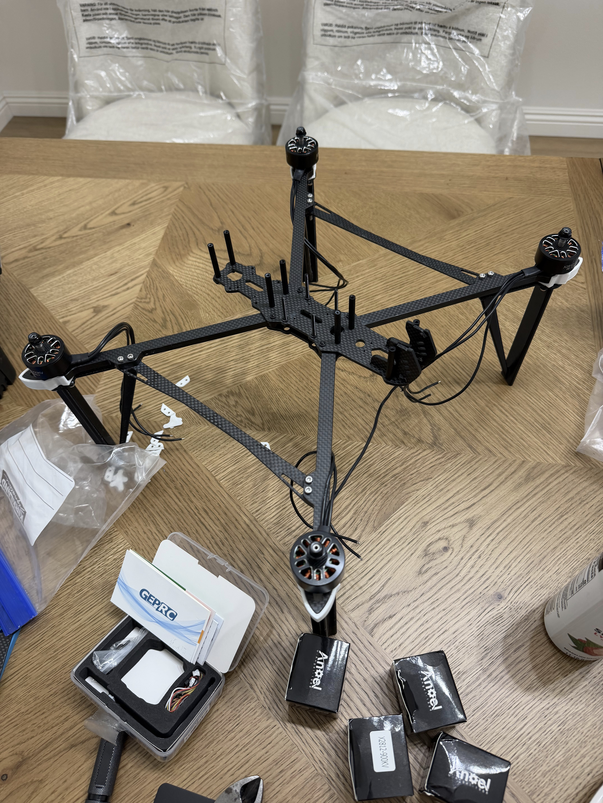
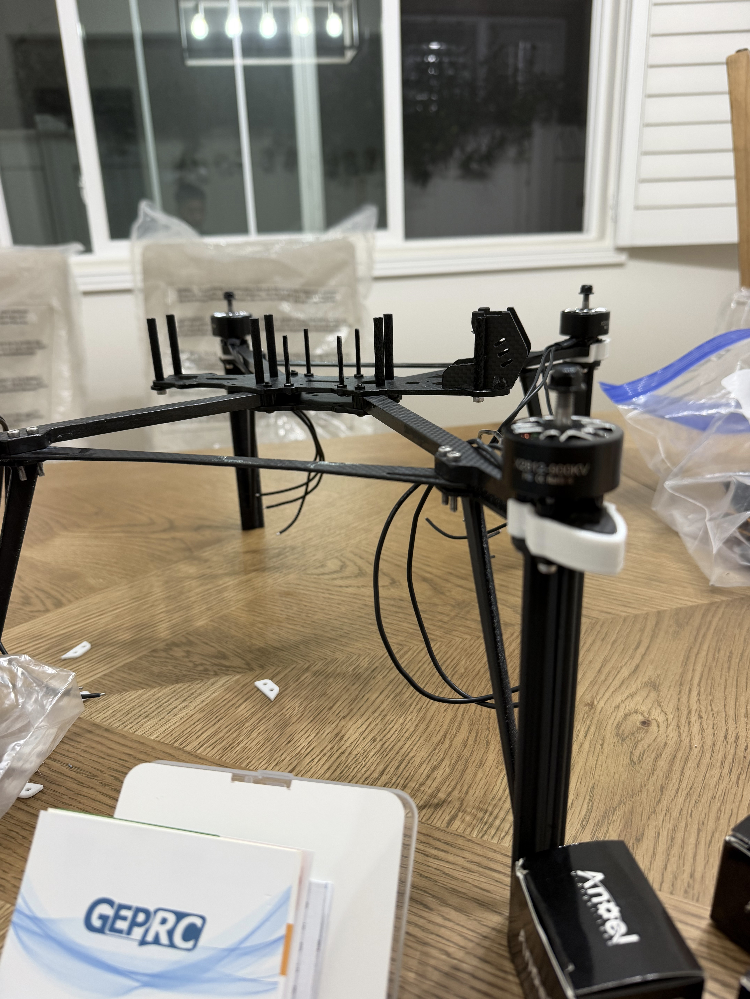
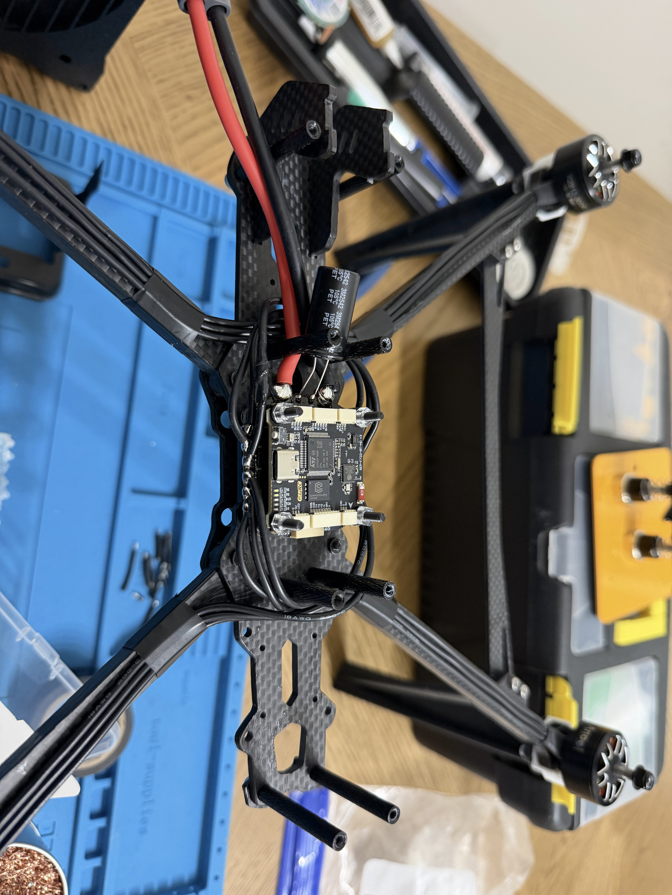

# October 17: Started assembling prebuilt parts and mapping out layout.

Spent the day assembling the drone frame with the extended feet and motors to keep the drone components away from abrasive sand. Took a bit as the 3D prints and screws were long and hard to align. I then mapped out the rough orientation for the drone and put in the esc, and tinned and soldered the motor wires to the esc. Noticed it took a long time to melt the main battery pads with the Pinecil V2 at max power 65w. Also added the 1000uf 50v capacitor. Routed the motor wires around to the opposite pads to leave room for error so i can strip and solder the wires again.

**Total time spent: 1.82 hours**

# FORMAT: Date: Short Description

descriptions with images

**Total time spent: _ hours**
